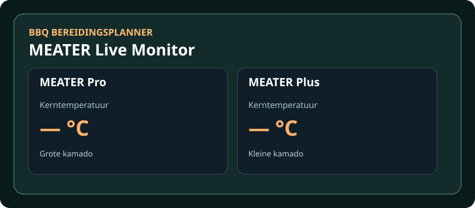

# BBQ Bereidingsplanner + MEATER

Een mobiele BBQ-bereidingsplanner voor **één grote en één kleine kamado**, met live MEATER Pro/Plus-gegevens via Home Assistant.



*Illustratie van de interface, niet een live MEATER-meting.*

## Mogelijkheden

- Gerechten toevoegen, wijzigen, verwijderen en aan grote of kleine kamado koppelen.
- Eén gewenste serveertijd, automatisch teruggerekende start-, bereidings- en rusttijden.
- Temperaturen en mogelijke kamadoconflicten; visuele tijdlijnen en draaiboek.
- MEATER Pro en MEATER Plus: kerntemperatuur, omgeving, doeltemperatuur, kookstatus, resterende tijd en meetverloop.
- Slimme bijsturing: vaste of flexibele serveertijd met adviezen op basis van geldige MEATER-ETA's.
- Werkt als Home Assistant-dashboardkaart en behoudt de afzonderlijke zelfstandige HTML-planner.
- Klikbare stappen in **04 Draaiboek** met voorbereiden, garen, rusten en aansnijden, inclusief een uitgewerkt **Ribeye 500 g**-recept.
- Een recept toevoegen via internetlink (alleen als de bron CORS-toegang toestaat) of door de recepttekst te plakken. Eigen recepten blijven lokaal beschikbaar als voorbeeldgerecht.
- Bewaar een beoordeling na iedere bereiding, met je uiteindelijke kern, instellingen en optioneel de recente MEATER-kern/omgeving. Vanaf v4.4.0 synchroniseert deze bereidingshistorie in de Home Assistant-kaart per ingelogd gebruikersaccount; eerdere beoordelingen zijn zichtbaar als je hetzelfde gerecht opnieuw bereidt.
- MEATER-grafieken tonen nu **kern én omgeving** in °C, op een gezamenlijke schaal en met tijden.

**Let op:** handmatige bereidingstijden zijn schattingen; MEATER-waarden zijn echte metingen uit Home Assistant met mogelijke vertraging. De planner is geen vervanging voor voedselveiligheidscontroles. Live-informatie verschijnt alleen in de Home Assistant-dashboardkaart.

## Openbare website om met vrienden te delen

Je kunt deze planner ook **zonder Home Assistant** als website gebruiken, op iPhone of Android.
Het publieke websiteadres is **https://eelbrethouwer-jpg.github.io/bbq_planner_card/** zodra GitHub Pages is ingeschakeld.

**Eenmalig activeren:** Open [Settings → Pages](https://github.com/eelbrethouwer-jpg/bbq_planner_card/settings/pages), kies **Deploy from a branch**, stel **main** en **/(root)** in en klik op **Save**. Zie [WEBSITE.md](WEBSITE.md) voor de volledige uitleg.

De vaste webpagina `index.html` opent automatisch de bestaande zelfstandige HTML-planner onder `dist/`, zodat de Home Assistant-code en de openbare website dezelfde planner blijven gebruiken.

- Met **↗ Deel website** kun je vanaf een iPhone via het deelmenu (bijvoorbeeld WhatsApp) de openbare link doorsturen.
- Iedereen beheert op de **openbare website** zijn eigen recepten en reviews in de lokale browseropslag. In de **Home Assistant-dashboardkaart** synchroniseren eigen recepten vanaf v4.3.0 en bereidingsevaluaties vanaf v4.4.0 met de beveiligde gebruikersopslag van het ingelogde Home Assistant-account. De publieke site synchroniseert niet automatisch; recepten zijn via JSON te back-uppen.
- De openbare website leest **geen** Home Assistant- of MEATER-gegevens. De bestaande ingelogde HA-dashboardkaart blijft de enige live-bron.
- De deelknop deelt alleen het **websiteadres**, nooit jouw eigen planning of sensorwaarden.

## Installatie via HACS (custom repository)

1. Open HACS in Home Assistant > menu met drie puntjes > **Aangepaste repositories**.
2. Voeg deze repository toe als categorie **Dashboard**.
3. Download de repository via HACS. HACS plaatst de bestanden in `config/www/community/bbq_planner_card/`.
4. Controleer of de planner op de volgende locatie opent, met je normale Home Assistant-host: `/hacsfiles/bbq_planner_card/BBQ_bereidingsplanner_MEATER_v4.html`.
5. Voeg als **JavaScript-module** de dashboardbron toe: `/hacsfiles/bbq_planner_card/bbq_planner_card.js`.
6. Plaats onderstaande handmatige kaart in je dashboard:

```yaml
type: custom:bbq-planner-meater-card
```

**Overstap vanaf handmatige versie:** voeg **niet** beide JavaScript-resources tegelijk toe. Vervang de oude `/local/BBQplanner/bbq-planner-ha-card.js`-resource door de nieuwe `/hacsfiles/...`-resource. Je bestaande kaart-YAML blijft gelijk. Maak eventueel eerst een back-up van je instellingen.

## Live-koppeling

De kaart leest Home Assistant-entiteiten via de ingelogde `hass`-sessie en stuurt alleen hun meetwaarden door aan de lokale planner-iframe. **Geen toegangstoken in de code.**

Deze release verwacht de volgende sensorprefixes (op maat voor deze installatie):

- MEATER Pro: `sensor.meater_probe_00e865be_`
- MEATER Plus: `sensor.meater_probe_c7dbf045_`

Bij andere apparaten of entiteitsnamen zijn deze prefixes in `dist/bbq_planner_card.js` aan te passen.

## Versies

De huidige `main`-code bevat **v4.3.0** met de receptenbibliotheek en Home Assistant-receptensynchronisatie. **v4.4.0** is als releasekandidaat voorbereid met gesynchroniseerde bereidingshistorie. HACS ziet v4.4.0 pas na merge en de officiële GitHub Release met tag `v4.4.0`.

Zie [CHANGELOG.md](CHANGELOG.md) voor wijzigingen. Publiceer een nieuwe GitHub Release met een versietag als je een versie wilt uitbrengen. De HACS-workflow controleert de repository automatisch op iedere push, pull request en via een geplande controle.

## Nieuw in de voorbereide v4.2.0

- **Datum automatisch vandaag.** Bij een bestaande planning uit v4.1.0 wordt een oude verlopen datum automatisch bijgewerkt; een zelfgekozen toekomstige datum blijft behouden. Handmatig kiezen zet de datum vast; `Vandaag gebruiken` schakelt terug naar automatisch. Bij import uit een bestand wordt de oude datum als bewuste keuze behouden, tenzij het bestand expliciet automatisch aangeeft.
- **Recepten zoeken en filteren:** categorie zoals rund, varken, gevogelte, lam, vis, groenten, vegetarisch en dessert. Eigen recepten worden ook doorzocht.
- **Bereidingsmethode en roosters:** kies direct/indirect, reverse sear of direct-naar-indirect, met RVS/gietijzer/plancha/pizzasteen. Bij indirect is een hitteschild nodig. Stel optioneel per kamado je daadwerkelijk aanwezige accessoires in; zonder die gegevens is een advies geen bewijs dat je het rooster hebt.
- **Ombouwfasen:** bij twee bereidingsfasen worden de opgegeven ombouwminuten aan de bereidingstijd toegevoegd. De tijdlijn toont de verschillende fasen en waarschuwt wanneer de grote/kleine kamado gelijktijdig twee verschillende roosters, methoden of temperaturen vereist. Bij wissels tussen afzonderlijke gerechten wordt een korte waarschuwing getoond; de planner kan niet bepalen hoeveel tijd jouw kamado werkelijk nodig heeft om af te koelen/op te stoken.
- **Offline receptgenerator:** open de generator, plak recepttekst en klik **Analyseer recept**. Het programma herkent waar mogelijk ingrediënten, naam, kern- en BBQ-temperatuur, tijden en instructiestappen. Controleer het concept en wijzig de velden en stappen voordat je **Recept goedkeuren en bewaren** kiest. Een lege onbekende temperatuur blijft leeg; het is nooit een live meting of gegarandeerd voedselveilige waarde. De eenvoudige oude import blijft als alternatief.
- **Stappen individueel bewerken:** gerechten kunnen uitgebreide instructies met eigen triggers bewaren. Receptbibliotheek, reviews en tijdlijnen van v4.1.0 blijven bestaan.
- **Pulled pork op brood:** standaardrecept met 2 kg procureur, indirect 120 °C, 7–11 uur als bereik, minimaal 1 uur rust en negen uitklapbare stappen. Het instelbare richtpunt 92 °C is een `priktest`-herinnering, geen automatisch gaarverklaring.

Deze nieuwe functies zijn in de releasebranch beschikbaar voor test; ze zijn **nog niet** opgenomen in de gepubliceerde HACS-release.

## Bereidingshistorie synchroniseren (v4.4.0)

Vanaf v4.4.0 wordt ook de **bereidingsevaluatie per gerecht** via Home Assistant gesynchroniseerd. Een review bevat de beoordeling, werkelijk ingevoerde eindkerntemperatuur, ingestelde BBQ-/kerntemperatuur, gekozen thermometer, een recente MEATER-kern/omgeving indien beschikbaar, en je opmerkingen voor de volgende bereiding. De vijf meest recente reviews van hetzelfde gerecht staan direct op de gerechtkaart.

De synchronisatie gebruikt hetzelfde ingelogde Home Assistant-account als de receptenbibliotheek en vraagt geen los token of externe cloudservice. Bestaande lokale reviews worden bij de eerste Home Assistant-koppeling samengevoegd met de opgeslagen historie van dat account. Maximaal 250 reviews worden bewaard. Op de openbare GitHub Pages-versie blijft de historie bewust lokaal in die browser.

## Mijn receptenbibliotheek en synchronisatie (v4.3.0)

Open **Mijn receptenbibliotheek** onder de receptgenerator in het dashboard. Hier kun je eigen recepten bekijken, bewerken, verwijderen, aan de planning toevoegen en een volledige JSON-back-up maken. Met **Recepten importeren** kies je tussen samenvoegen en volledig vervangen; bij vervangen verschijnt een extra bevestiging.

**Geen extra installatie nodig voor synchronisatie:** de reeds ingelogde Home Assistant-kaart gebruikt Home Assistant's eigen persoonlijke frontend-opslag via de WebSocket-verbinding. Recepten worden gekoppeld aan het **gebruikersaccount**, niet aan het fysieke apparaat. Als je op iPhone en computer dezelfde Home Assistant-gebruiker gebruikt, zijn de eigen recepten daar na synchronisatie te zien. Meerdere verschillende HA-gebruikers hebben elk een **aparte** bibliotheek.

**De openbare GitHub Pages-versie** heeft bewust geen toegang tot je Home Assistant-opslag. Hier werkt de receptenbibliotheek lokaal; importeer/exporteer het JSON-bestand om recepten over te zetten. Bewaar je backups veilig. Er worden geen persoonlijke recepten of inloggegevens automatisch naar GitHub geüpload.

**Beperkingen:** voor zeer gelijktijdige bewerkingen van hetzelfde recept geldt een last-write-wins-gedrag op basis van de opgeslagen wijzigingstijd. De import/export betreft recepten, **niet** alle oude reviews of planningen. Het maximum is 80 eigen recepten. De standaardrecepten zijn steeds beschikbaar in de app. Home Assistant- en Safari-apparaatproeven staan nog op de releasechecklist.

## Recepten en evaluaties (v4.1.0)

De receptenbibliotheek staat lokaal in de **browseropslag (localStorage)** en wordt bij gebruik van de Home Assistant-dashboardkaart vanaf v4.3.0 ook in de persoonlijke opslag van het ingelogde HA-account bewaard. Vanaf v4.4.0 geldt dat ook voor de **bereidingsevaluaties/reviewhistorie**. Het laden van een planning in JSON bevat de receptvelden van de gerechten; de losse receptenbibliotheek en reviewhistorie zitten niet in het planbestand. Op de openbare website blijven reviews uitsluitend lokaal. Het resetten van de voorbeeldplanning wist de bibliotheek en reviews niet.

Een gewone receptlink wordt alleen automatisch gelezen als de website toegang via de browser toestaat én gestructureerde Recipe-gegevens aanbiedt. Anders kun je de tekst plakken. Dit programma omzeilt geen CORS-beveiliging en maakt geen gebruik van externe scraping- of AI-services. Controleer de geïmporteerde bereidingsinstructies, allergenen en voedselveiligheid.

De gecombineerde MEATER-grafiek toont uitsluitend meetpunten die zijn binnengekomen **terwijl de planner openstaat**. Er is geen volledige Home Assistant-historie opgehaald; er worden geen voorbeeldcurves gegenereerd.

## Veiligheid

Bereidingstijden en MEATER-ETA's zijn indicaties. Controleer veilige kerntemperaturen volgens het gerecht, gebruik een geschikt meetpunt en ga niet uitsluitend op de planner af. Publiceer nooit Home Assistant-toegangstokens, wachtwoorden of persoonlijke netwerkgegevens in deze publieke repository.