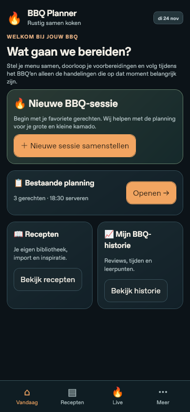
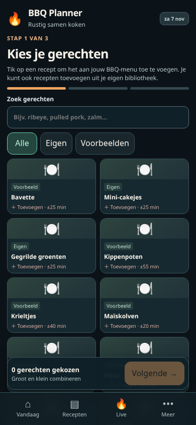
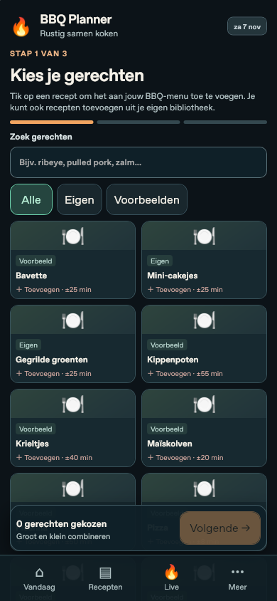
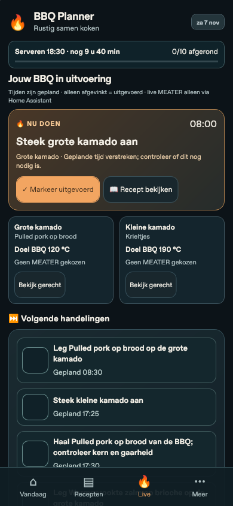
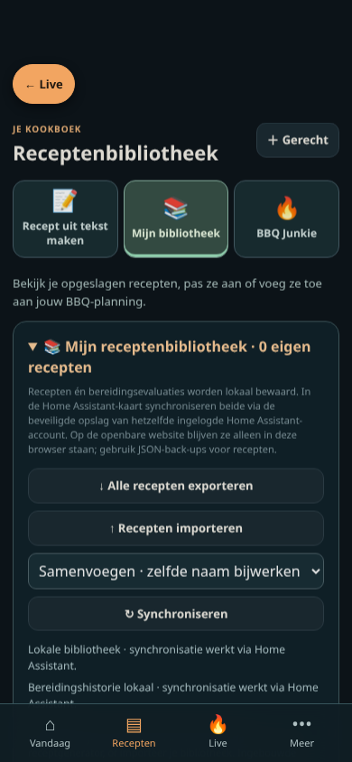
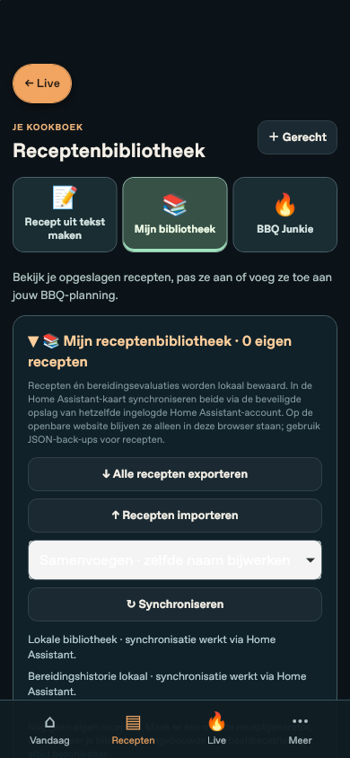
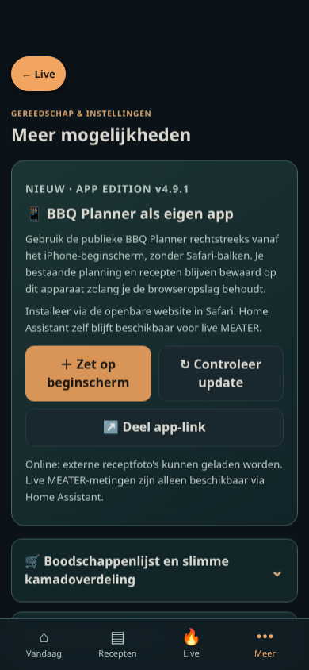

# v5.1.0 — browserbeelden

Zelf gegenereerd met `SCREENSHOTS_DIR=docs/screenshots/v5.1.0 node tests/mobile-bounds.mjs` op 7 november 2026. Viewport **390×844 CSS-pixels**, schaal 1; Chromium en WebKit met mobiele touchsimulatie. Testplanning: drie gerechten, geen live MEATER. Geen fysieke iPhone- of gebruikersgegevens.

| Scherm | Chromium | WebKit |
|---|---|---|
| Vandaag |  |  |
| Kies gerechten |  |  |
| Live |  |  |
| Recepten |  |  |
| Meer |  |  |
