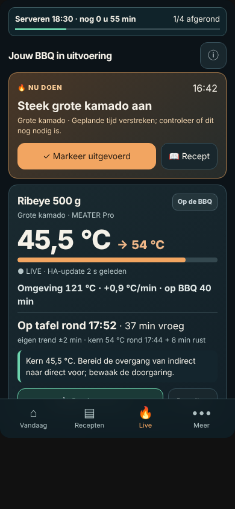
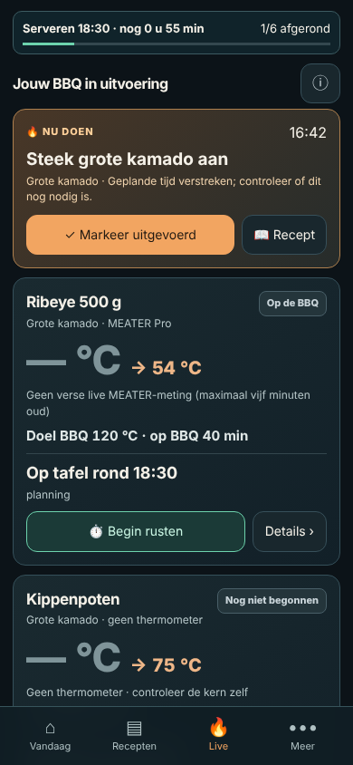
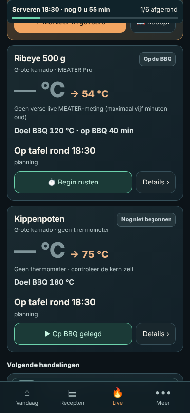
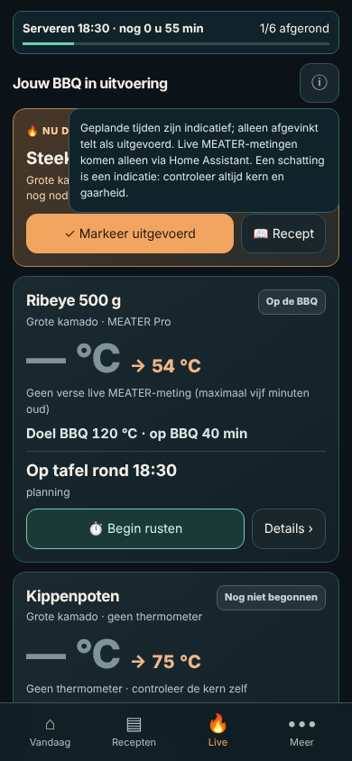
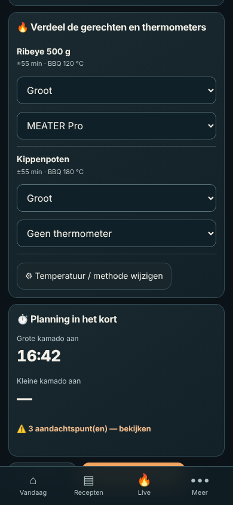

# v5.3.0 — browserbeelden Live-gerechtkaart

Zelf gegenereerd op 17 november 2026 met Python-Playwright en Google Chrome (Chromium), viewport **390×844 CSS-pixels**, schaal 1, mobiele touchsimulatie, tijdzone Europe/Amsterdam en een gesimuleerde klok. **WebKit-beelden ontbreken**: WebKit was in de bouwomgeving niet te installeren. De WebKit-layout wordt wel gecontroleerd in CI (`tests/v520-mobile-ux.mjs`, `tests/mobile-bounds.mjs`).

**Alle meetwaarden zijn gesimuleerde fixtures**, geen echte Home Assistant-, MEATER- of iPhone-gegevens. De HA-beelden laden de echte kaart `dist/bbq_planner_card.js` met nagebootste HA-sensorstaten.

Scenario "zoals gisteren": Ribeye 500 g, MEATER Pro gekoppeld, geen kooksessie in de MEATER-app. De kern stijgt in 40 minuten van 9,5 naar 45,5 °C bij 121 °C omgeving; tijdstip 17:35.

| Beeld | Bestand |
|---|---|
| HA-kaart, eigen trend als bron |  |
| HA-kaart, met MEATER-ETA (status `started`, doel 54) |  |
| Publieke PWA zonder HA: streepjes, planning als bron |  |
| Publieke PWA, twee gerechten op één kamado |  |
| Uitleg achter ⓘ |  |
| Stap 2: kamado en thermometer |  |
