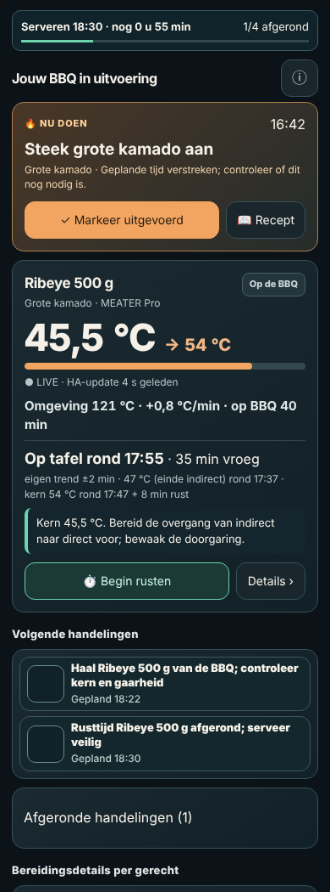
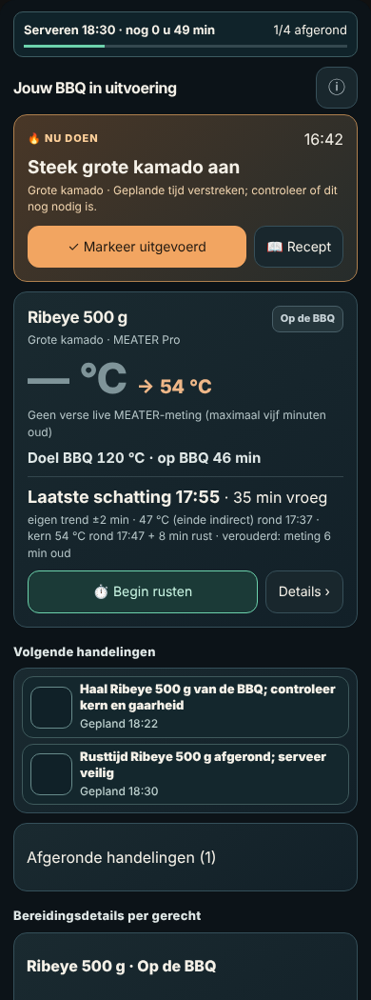
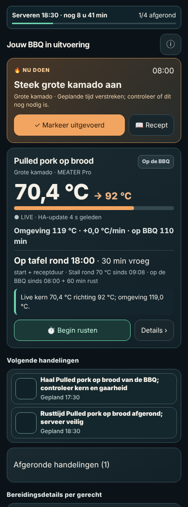

# v5.4.0 — browserbeelden eigen schattingsmodule

Zelf gegenereerd op 17 november 2026 met Python-Playwright en Google Chrome (Chromium), viewport **390×844 CSS-pixels**, schaal 1, mobiele touchsimulatie, tijdzone Europe/Amsterdam en een gesimuleerde klok. Uitsnede: bovenste 1050 px van Live. **WebKit-beelden ontbreken**: WebKit is in de bouwomgeving niet beschikbaar. De WebKit-layout wordt wel gecontroleerd in CI (`tests/v520-mobile-ux.mjs`, `tests/mobile-bounds.mjs`).

**Alle meetwaarden zijn gesimuleerde fixtures**, geen echte Home Assistant-, MEATER- of iPhone-gegevens. De beelden laden de echte kaart `dist/bbq_planner_card.js` met nagebootste HA-sensorstaten en een nagebootst antwoord op `history/history_during_period`.

| Beeld | Scenario | Bestand |
|---|---|---|
| "Zoals gisteren", eigen curve | Ribeye 500 g, MEATER Pro, geen kooksessie in de MEATER-app. Om 16:55 op de BBQ gelegd; het dashboard gaat om 17:35 open. De meetgeschiedenis (9,5 → 45,5 °C bij 121 °C, elke 30 s) komt uit HA, dus de schatting staat er direct: op tafel rond 17:55, 47 °C (einde indirect) rond 17:37, kern 54 °C rond 17:47 + 8 min rust. |  |
| Verouderde meting | Zelfde sessie, 6 minuten geen nieuwe meting: "Laatste schatting 17:55 · verouderd: meting 6 min oud". Geen sprong naar de planning (18:30). |  |
| Stall (procureur) | Pulled pork om 08:00 op de BBQ. De kern staat 40 min rond 70 °C. De kaart toont "Stall rond 70 °C sinds 09:08" zonder curvetijd; bron: start + receptduur. |  |

Na 16 minuten zonder meting (niet als beeld) toont de kaart "Op tafel rond 18:13 · start + receptduur": 16:55 + 55 min + 15 min ombouw + 8 min rust.
